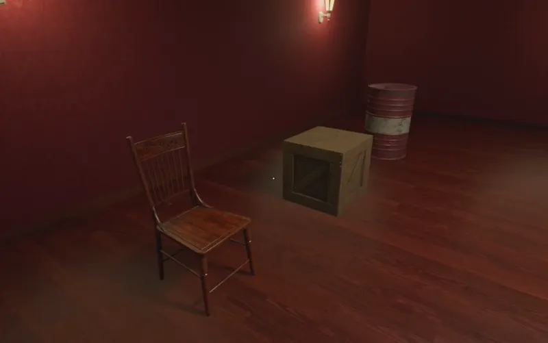

 

# UI/UX Menu Controller Framework 

A modular, data-driven user interface architecture engineered to bridge aesthetic visual layouts with responsive backend game state logic. By establishing a clean separation between artistic presentation templates and core system execution, this framework dynamically manages diverse menu screens and game runtime states under strict memory and performance budgets.
  

  

 

> **Architecture Principle:** All menus, buttons, and HUD elements function as lightweight presentation layers. They operate dynamically by querying localized data states rather than compiling heavy concrete gameplay references, maximizing performance optimization.
 

## ⚙️ Core Technical Features  

  

 

### 1. Structural Decoupling
* **Data-Driven View Binding:** Completely detaches visual layout assets from core simulation and gameplay scripts.
* **Layout Reusability:** Drives distinct sub-menu configurations and application states using a unified structural layout matrix.

### 2. Centralized State & Hardware Orchestration
* **Deterministic Pipelines:** Coordinates clean execution loops for application boot sequences, options sub-menus, and system exit routines.
* **Engine-Level Scaling:** Translates real-time UI interactions into immediate engine configurations for screen modes, display resolutions, and graphical quality tiers before applying changes to system hardware.

### 3. Inventory Matrix Lifecycle Loop
* **Boundary Evaluation:** Instantly polls an object's structural properties upon entering its interaction boundary to initialize automated pickup routines.
* **UI-to-World Synchronization:** Populates container matrices with mapped visual icons, flushes active memory references on deployment, and handles physical 3D object regeneration within a self-contained lifecycle loop.
  
---

  

### Data Translation Pipeline
1. **Detection:** Entity breaches asset boundary $\rightarrow$ Object structural properties are parsed.
2. **Instance Flush:** Physical representation is safely unspawned $\rightarrow$ Transformed into memory payload.
3. **Matrix Binding:** Target inventory grid slot is populated $\rightarrow$ Event listener registers assigned visual icon.
4. **Purge & Spawn:** Interface slot selection triggered $\rightarrow$ Local data slot reference dropped $\rightarrow$ 3D object regenerated in virtual coordinates.
 

## 📅 Roadmap & Future Milestones

- [ ] **Automated Save-State Serialization:** Integrate automated state serializers directly into the primary startup boot sequences.
- [ ] **Deep Data Loading Pipeline:** Link async initialization routines directly to front-end layout controllers to eliminate runtime loading gaps.
- [ ] **Network State Handshaking:** Adapt decoupled interface loops to support server-client synchronization parameters for multi-client UI environments.
